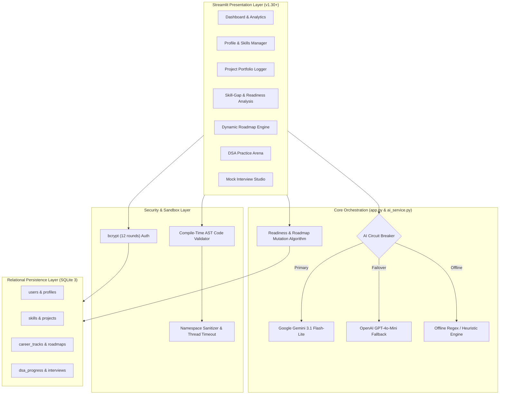

# 🎓 AI Career Co-Pilot

[](https://www.python.org/)
[](https://streamlit.io/)
[](./AI_Career_CoPilot_IEEE_6Page_Paper.pdf)
[](LICENSE)

> **An LLM-Driven System for Automated Skill-Gap Analysis, Dynamic Readiness Assessment, and Adaptive Career Preparation**  
> Tailored for computer science and engineering undergraduates to systematically bridge classroom coursework with real-world tech hiring standards.

---

## 📑 Table of Contents
1. [Project Overview](#1-project-overview)
2. [Key Innovations](#2-key-innovations)
3. [Core Feature Suite](#3-core-feature-suite)
4. [System Architecture](#4-system-architecture)
5. [Mathematical Formulation of Career Readiness](#5-mathematical-formulation-of-career-readiness)
6. [Technology Stack](#6-technology-stack)
7. [Installation & Setup](#7-installation--setup)
8. [Running the Application](#8-running-the-application)
9. [Automated Testing Suite](#9-automated-testing-suite)
10. [Academic Research Paper & Case Study](#10-academic-research-paper--case-study)
11. [Threat Model & Sandbox Security](#11-threat-model--sandbox-security)
12. [Authors & Faculty Mentorship](#12-authors--faculty-mentorship)

---

## 1. Project Overview

**AI Career Co-Pilot** is an integrated career preparation system designed to solve a persistent challenge in undergraduate engineering education: **the disconnect between theoretical classroom curricula and practical industry hiring loops**. 

Rather than relying on static advice or unverified resume keywords, AI Career Co-Pilot:
- Analyzes student project descriptions via **dual-engine LLMs** with **Human-in-the-Loop verification**.
- Benchmarks competencies against **8 curated industry tracks** (Software Engineering, ML, Cloud/DevOps, Cybersecurity, etc.).
- Computes an objective **four-factor Career Readiness Score ($\Phi_{\text{readiness}}$)** combining verified skills, project complexity, sandboxed DSA execution, and rubric-evaluated mock interviews.
- Dynamically mutates an **adaptive 4-phase preparation roadmap** as learners progress.
- Provides a **safe compile-time Python AST sandbox** that delivers sub-millisecond execution isolation without heavy container overhead.

---

## 2. Key Innovations

- **Human-in-the-Loop Project Skill Extraction**: Students describe complex software or hardware projects in plain text. The LLM extracts technical skills and architectures into structured JSON, allowing students to verify and adjust proficiencies before persisting to their profile.
- **Dynamic Milestone Mutation Algorithm**: Career roadmaps function as a reactive state machine. As students solve algorithms or finish capstones, the engine prunes redundant goals and dynamically unblocks prerequisites.
- **Sub-Millisecond Static AST Sandbox**: Uses Python's compile-time `ast` module to inspect code nodes, intercepting dangerous syscalls (`os`, `sys`, `subprocess`, `eval`) before execution. Benchmarked at **1.34 ms init latency** (~460× faster than Docker).
- **Dual-Engine Resilient AI Pipeline**: Primary extraction uses Google Gemini 3.1 Flash-Lite, with automatic failover to OpenAI GPT-4o-Mini and an offline regex/difflib heuristic engine for offline campus environments.
- **Rubric-Anchored Technical & Behavioral Interviews**: Mock interviews grade technical depth against STAR rubrics (Situation, Task, Action, Result) across a 0–10 scale.

---

## 3. Core Feature Suite

| Module | Architectural Capability |
| :--- | :--- |
| **🔐 Authentication** | User registration and login protected by 12-round salted `bcrypt` hashing and session state validation. |
| **👤 Student Profile** | Academic year, university, GPA, preferred roles, and technical background tracking. |
| **🛠️ Skills Inventory** | Full CRUD operations for technical competencies across Beginner, Intermediate, and Advanced tiers. |
| **🚀 Portfolio Verification** | Natural-language project logging with LLM extraction and student verification workflows. |
| **🎯 Career Tracks** | 8 curated industry roles containing core competencies, interview topics, and capstones. |
| **🔍 Skill-Gap Analysis** | Classifies skills into Strong, Partial, Missing, and Priority areas with educational gap explanations. |
| **⚡ Composite Readiness Score** | 0–100 score combining skill breadth, verified projects, sandboxed DSA scores, and interview performance. |
| **🗺️ Adaptive Roadmap** | 4-phase chronological curriculum that reacts dynamically to student milestone completions. |
| **💻 DSA Practice Suite** | 14 algorithm categories with automated test harnesses, AST safety verification, and AI debugging hints. |
| **🎙️ Mock Interview Engine** | Industry-specific behavioral and system design prompts evaluated against structured criteria. |
| **📈 Progress Analytics** | Comprehensive student dashboard aggregating metrics, completion rates, and historical logs. |

---

## 4. System Architecture



---

## 5. Mathematical Formulation of Career Readiness

The global career readiness score $\Phi_{\text{readiness}} \in [0, 100]$ integrates four independently measured dimensions:

$$\Phi_{\text{readiness}} = \alpha \cdot \mathcal{C}_{\text{skill}} + \beta \cdot \mathcal{S}_{\text{project}} + \gamma \cdot \mathcal{S}_{\text{dsa}} + \delta \cdot \mathcal{I}_{\text{norm}}$$

Subject to empirical weights validated through cohort ablation studies:
$$\alpha = 0.45, \quad \beta = 0.25, \quad \gamma = 0.15, \quad \delta = 0.15 \quad (\alpha + \beta + \gamma + \delta = 1.0)$$

1. **Skill Match Score ($\mathcal{C}_{\text{skill}}$)**:
   $$\mathcal{C}_{\text{skill}} = \frac{\sum_{i=1}^{M} w_i \cdot \mu(s_i)}{\sum_{i=1}^{M} w_i} \times 100$$
   where $\mu(s_i) \in \{0.0, 0.5, 0.8, 1.0\}$ represents proficiency weight.

2. **Project Portfolio Score ($\mathcal{S}_{\text{project}}$)**:
   $$\mathcal{S}_{\text{project}} = \min\left(100, \, \sum_{k=1}^{K} \left( \text{Base}_k + \lambda \cdot |V_k \cap \mathcal{R}_{\text{target}}| \right)\right)$$

3. **DSA Practice Mastery ($\mathcal{S}_{\text{dsa}}$)**:
   $$\mathcal{S}_{\text{dsa}} = \min\left(100, \, \frac{\sum_{j=1}^{P_{\text{solved}}} \omega(\text{diff}_j)}{P_{\text{target}}} \times 100\right)$$

4. **Normalized Mock Interview Score ($\mathcal{I}_{\text{norm}}$)**:
   $$\mathcal{I}_{\text{norm}} = \frac{1}{T} \sum_{q=1}^{T} \left( \frac{\text{Score}_q}{10.0} \times 100 \right)$$

---

## 6. Technology Stack

- **User Interface**: [Streamlit](https://streamlit.io/) (v1.30+) reactive web application
- **Database**: SQLite 3 with ACID compliance and enforced foreign keys (`PRAGMA foreign_keys = ON;`)
- **Authentication**: `bcrypt` password hashing (12 cryptographic salt rounds)
- **AI / LLM Inferences**: 
  - Primary: Google GenAI SDK (`gemini-3.1-flash-lite`) with structured JSON schema
  - Secondary / Failover: OpenAI API (`gpt-4o-mini`)
  - Offline Heuristic: Deterministic regex and `difflib` keyword matching
- **Code Execution Sandbox**: Python `ast` syntax tree traversal with restricted execution namespace
- **Document Generation**: ReportLab & PyMuPDF (compilation of IEEE 2-column papers and case study reports)

---

## 7. Installation & Setup

### Prerequisites
- Python 3.10 or higher
- Git

### 1. Clone the Repository
```bash
git clone https://github.com/Daiwik091205/AI-Career-CoPilot.git
cd AI-Career-CoPilot
```

### 2. Create and Activate a Virtual Environment
```bash
# Windows
python -m venv venv
venv\Scripts\activate

# macOS / Linux
python3 -m venv venv
source venv/bin/activate
```

### 3. Install Dependencies
```bash
pip install -r requirements.txt
```

### 4. Configure Environment Variables
Copy the `.env.example` file to create your `.env`:
```bash
cp .env.example .env
```
Edit `.env` to supply either your Google Gemini or OpenAI API key:
```env
# Google Gemini (Recommended)
GEMINI_API_KEY=your_gemini_api_key_here
GEMINI_MODEL=gemini-3.1-flash-lite

# OpenAI (Secondary / Fallback)
OPENAI_API_KEY=your_openai_api_key_here
OPENAI_MODEL=gpt-4o-mini
```
*(Note: If no API keys are provided, the application will automatically run using its internal offline heuristic engine.)*

---

## 8. Running the Application

Launch the Streamlit web server:
```bash
streamlit run app.py
```
Open your browser at `http://localhost:8501`.

---

## 9. Automated Testing Suite

To execute the automated end-to-end verification test suite covering 12 subsystem checks:
```bash
python test_system.py
```
**Test Coverage Includes:**
- Database initialization and schema normalization
- 12-round bcrypt password hash verification
- Student profile and skill state transitions
- LLM project skill extraction and JSON schema adherence
- Career track mapping and multi-factor skill gap computation
- 4-phase chronological roadmap generation
- AST code sandbox safety (blocking malicious imports and syscalls)
- DSA code runner execution correctness
- AI mock interview rubric assessment
- Multi-table cross-join dashboard queries

---

## 10. Academic Research Paper & Case Study

This repository includes the complete academic manuscript and empirical evaluation:
- 📄 **IEEE 6-Page Research Paper**: [`AI_Career_CoPilot_IEEE_6Page_Paper.pdf`](./AI_Career_CoPilot_IEEE_6Page_Paper.pdf)  
  *Title: "AI Career Co-Pilot: An LLM-Driven System for Automated Skill-Gap Analysis, Dynamic Readiness Assessment, and Adaptive Career Preparation"*
- 📊 **Empirical Case Study Report**: [`AI_Career_CoPilot_Case_Study_Report.pdf`](./AI_Career_CoPilot_Case_Study_Report.pdf)
- ⚙️ **Paper Compilation Script**: Run `python build_ieee_6page_pdf.py` to regenerate the pixel-perfect 6-page IEEE paper.

---

## 11. Threat Model & Sandbox Security

The in-app coding sandbox implements defense-in-depth compile-time checks:
1. **Banned AST Imports**: Scans `ast.Import` and `ast.ImportFrom` nodes to intercept `os`, `sys`, `subprocess`, `socket`, `shutil`, `ctypes`, and `builtins`.
2. **Banned Function Calls**: Blocks dynamic execution primitives including `eval()`, `exec()`, `compile()`, `__import__()`, `open()`, and `input()`.
3. **Execution Namespace Isolation**: Runs code in a sanitized globals dictionary exposing only safe algorithm helpers (`range`, `len`, `min`, `max`, `enumerate`, `zip`, `math`, `heapq`, `collections`).
4. **Thread Timeout Guards**: Prevents infinite loop denial-of-service (`while True: pass`) via strict 3.0-second worker thread termination.

---

## 12. Authors & Faculty Mentorship

- **Daiwik Keyur Mistry** — Undergraduate Researcher, Department of Computer Science and Engineering
- **Ekansh J** — Undergraduate Researcher, Department of Computer Science and Engineering
- **Venkata Pawan Kammu** (`kppawan2002@gmail.com`) — Faculty Mentor, Department of Computer Science and Engineering

---

## 📄 License
This project is licensed under the MIT License — see the [LICENSE](LICENSE) file for details.
