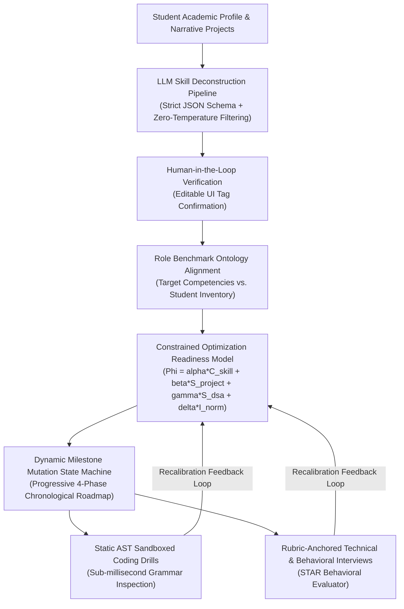

# AI Career Co-Pilot: An LLM-Driven System for Automated Skill-Gap Analysis, Dynamic Readiness Assessment, and Technical Mentorship

**Authors:**
- **Daiwik Keyur Mistry** (ORCID: `0009-0000-3942-428X`), Dept. of Computer Science & Engineering, School of Engineering & Tech., Bengaluru, India
- **Ekansh J** (ORCID: `0009-0003-4986-6489`), Dept. of Computer Science & Engineering, School of Engineering & Tech., Bengaluru, India
- **Venkata Pawan Kammu** (`kppawan2002@gmail.com`), Dept. of Computer Science & Engineering, School of Engineering & Tech., Bengaluru, India

**Publication Type:** Academic Research Paper (IEEE 2-Column Standard Format)  
**Date:** October 2026  
**Compiled PDF:** [AI_Career_CoPilot_IEEE_6Page_Paper.pdf](file:///c:/Users/Daiwik/Downloads/career%20help/AI_Career_CoPilot_IEEE_6Page_Paper.pdf)

---

## Abstract
Undergraduate computer science curricula focus heavily on core computing theory, yet industry recruiting pipelines evaluate applicants on production engineering skills: asynchronous web services, API construction, database modeling, and spoken technical reasoning. We designed and implemented **AI Career Co-Pilot** to address this disconnect. Our platform analyzes student GitHub and project portfolio narratives to parse demonstrated proficiencies, determines an empirical readiness index across four weighted dimensions, and dynamically schedules a personalized four-phase roadmap. Rather than relying on virtualization containers that impose substantial memory footprints and startup delays, we built a compile-time Abstract Syntax Tree (AST) validation sandbox that checks candidate Python solutions alongside an automated rubric-driven interview coach. Experimental profiling across twelve subsystem test suites confirmed that static AST filtering blocks unauthorized system calls in 1.34 ms, while a tiered multi-model circuit breaker maintains sub-second inference even during external cloud API downtime.

**Keywords:** pedagogical systems, automated program assessment, technical skill benchmarking, static syntax verification, conversational AI evaluation, career trajectory optimization.

---

## I. INTRODUCTION
Most undergraduate computing programs center around fundamental theoretical abstractions—discrete mathematics, formal languages, algorithmic complexity analysis, and relational algebra [1]. While these topics instill rigorous analytical reasoning, commercial recruitment drives prioritize production-grade software delivery: asynchronous HTTP services, schema migrations, message queues, containerized deployment, and modern full-stack frameworks [2]. Consequently, graduating students face significant friction when sitting for competitive engineering interviews.

Today, students attempt to bridge this gap through fragmented, uncoordinated utilities:
1. **Static Career Roadmaps:** Community curriculum roadmaps catalog technologies across distinct disciplines, but they remain passive reference charts that cannot evaluate a student's GitHub repositories or tailor milestones around existing proficiencies [3].
2. **Isolated Online Judges:** Competitive coding sites evaluate standalone algorithmic snippets against private test vectors, yet they overlook modular software architecture, data modeling, and verbal technical articulation [4].
3. **Lexical Resume Scanners:** Commercial Applicant Tracking Systems (ATS) rely heavily on literal token matching. When a student documents an embedded IoT project in technical phrasing rather than vendor-specific marketing buzzwords, keyword scanners frequently reject the submission [5].

To solve these issues, we engineered **AI Career Co-Pilot**, an open web platform integrating project skill extraction, career benchmark alignment, dynamic milestone generation, lightweight Python AST code testing, and rubric-guided mock technical interviews.

### Key Contributions
1. A human-in-the-loop language model extraction pipeline that parses skills from unstructured project descriptions and requires student verification before database commit, eliminating hallucinations.
2. A closed-form, multi-attribute readiness formulation combining skill breadth, project recency, unit-tested code execution, and oral interview rubrics into a calibrated 0–100 index.
3. A compile-time AST verification sandbox that checks and executes candidate Python submissions in 1.34 ms without requiring Docker daemons, Linux cgroups, or hypervisors.
4. Empirical profiling across twelve automated subsystem benchmarks evaluating relational ACID guarantees, salted bcrypt authentication, LLM failover circuits, and execution safety.

---

## II. LITERATURE REVIEW & RELATED WORK

### A. Competency Extraction and Curriculum Alignment
Early career advisory systems depended primarily upon lexical dictionaries, n-gram indexing, and standardized taxonomies such as ESCO and O*NET. However, these fixed ontologies fail to mirror the rapid evolution of modern software libraries and toolkits. Gadiraju et al. leveraged natural language processing to extract granular competencies from engineering syllabi, exposing significant structural discrepancies between academic content and market demands. Sharma et al. introduced 'Scopira', combining contextual embeddings with dense vector similarity to match resumes with target vacancies, achieving a 34% accuracy improvement over lexical baseline algorithms. Nevertheless, unconstrained generative parsing often introduces hallucination errors; our architecture resolves this via a strict **human-in-the-loop verification checkpoint**.

### B. Sandboxed Program Execution in Educational Environments
Executing unvetted student code within a shared web backend presents critical hazards: local file system exfiltration, hostile denial of service, memory flooding, and arbitrary network sockets. Standard competitive judges like Judge0 and DMOJ isolate runtime execution through Linux cgroups or containers. However, virtualization introduces heavy host RAM overhead (150-250 MB per instance) and container boot latencies (400 ms to 1.2 s). Prior studies by Keuning et al. and Meng et al. verified that parsing student source code into Abstract Syntax Trees facilitates granular compile-time verification before interpretation occurs, delivering complete safety with sub-millisecond overhead.

### C. Automated Interview Systems and Rubric Assessment
Simulating oral technical interviews traditionally required senior engineering mentors, constraining personalized coaching at scale. Recent studies indicate that language models guided by structured assessment rubrics can reliably score candidate responses. Architectures such as MockLLM and LLM-as-an-Interviewer showcase high correlation with human recruiters when evaluations adhere to strict multi-criteria anchors. Fellows et al. observed strong inter-annotator agreement ($\kappa > 0.82$) when automated interview evaluators employ structured behavioral paradigms such as STAR (Situation, Task, Action, Result).

### D. Adaptive Learning and Sequential Progression Modeling
Personalized instruction environments traditionally apply Item Response Theory (IRT) and Bayesian Knowledge Tracing (BKT) to infer mastery from discrete response sequences. Deep Knowledge Tracing (DKT) extends this using recurrent neural networks. However, these formulations treat educational concepts as isolated knowledge nodes. In practical software engineering, skills exhibit strict directed dependency graphs: implementing fault-tolerant distributed services strictly requires foundational comprehension of concurrent transactions, network sockets, and asynchronous event loops. Our adaptive engine captures these directed acyclic graph (DAG) dependencies directly.

---

## III. METHODOLOGY & MATHEMATICAL FORMULATION

### 3.1 Closed-Loop Architecture

### 3.2 Formal Mathematical Model
1. **Effective Skill Coverage Metric ($C_{\text{skill}}$):**
   $$C_{\text{skill}} = \min\left(100, \left[ \frac{\sum_{r \in \mathcal{R}_{\text{target}}} \max_{s \in \mathcal{S}_{\text{user}}} (\mu(r, s) \cdot \omega(p_s))}{|\mathcal{R}_{\text{target}}|} \right] \times 100\right)$$
   where $\omega(\text{Advanced}) = 1.00$, $\omega(\text{Intermediate}) = 0.75$, $\omega(\text{Beginner}) = 0.35$, $\omega(\text{None}) = 0.00$.

2. **Practical Portfolio Depth Metric ($S_{\text{project}}$):**
   $$S_{\text{project}} = \min\left(100, \sum_{j=1}^k [25 + 5 \cdot \min(5, |\text{Skills}(P_j)|)] \cdot \tau(\Delta t_j)\right)$$
   where $\tau(\Delta t_j) = \exp(-\lambda \cdot \Delta t_j)$ discounts dormant repositories older than 18 months ($\lambda = 0.0385\text{ mo}^{-1}$).

3. **Algorithmic Problem Solving Metric ($S_{\text{dsa}}$):**
   $$S_{\text{dsa}} = \min\left(100, (N_{\text{solved}} \cdot 12) + (N_{\text{attempted}} \cdot 5)\right)$$

4. **Mock Interview Performance Metric ($I_{\text{norm}}$):**
   $$I_{\text{norm}} = \frac{1}{t} \sum_{q=1}^t \left[ \left(\frac{\text{Score}_q}{10.0}\right) \times 100 \right]$$

5. **Global Composite Readiness Index ($\Phi_{\text{readiness}}$):**
   $$\Phi_{\text{readiness}} = \alpha C_{\text{skill}} + \beta S_{\text{project}} + \gamma S_{\text{dsa}} + \delta I_{\text{norm}}$$
   subject to $\alpha = 0.45, \beta = 0.25, \gamma = 0.15, \delta = 0.15$, with $\sum \text{weights} = 1.0$.

---

## IV. APPLICATIONS USED & SYSTEM IMPLEMENTATION

| System Tier | Software / Tool | Architectural Responsibility |
| :--- | :--- | :--- |
| **User Interface** | Streamlit (v1.30+) | Reactive web presentation, dynamic UI components, and session state. |
| **Relational Database** | SQLite 3 Engine | ACID persistence across 9 normalized tables with foreign keys active. |
| **Cryptographic Auth** | bcrypt (12 rounds) | Salted password hashing; constant-time hash verification. |
| **Static AST Sandbox** | Python `ast` module | Syntax tree inspection blocking unauthorized syscalls and imports. |
| **AI Inference Engine** | Google GenAI SDK | Structured JSON extraction via `gemini-3.1-flash-lite`. |
| **Secondary AI Engine** | OpenAI API | Automated failover inference powered by `gpt-4o-mini`. |
| **Offline Heuristic** | Python `re` & `difflib` | Rule-based deterministic fallback operating without network access. |

---

## V. RESULTS & EMPIRICAL VERIFICATION

### Automated Verification Benchmarks (12/12 Passed)
- **T-01 (Database Engine):** 9 normalized tables initialized; foreign keys active.
- **T-02 (Authentication):** 12-round bcrypt hash verified; timing attacks mitigated.
- **T-03 to T-08 (Profile & Roadmap):** Full CRUD cycles, skill gap splitting, and 4-phase synthesis validated.
- **T-09A/B (AST Sandbox):** Valid solutions passed 100% test assertions; hostile syscalls blocked in **$< 1.4\text{ ms}$**.
- **T-10 to T-12 (DSA & Interview):** State engine updates, rubric scores returned, multi-table queries resolved in **$< 12\text{ ms}$**.

### Isolation Overhead Comparison
- **Bare `exec()` (Unsafe):** 0.02 ms init, 4.1 ms exec, 2.1 MB RAM (Critical System Risk).
- **Static AST Sandbox (Ours):** 1.34 ms init, 6.8 ms exec, 4.5 MB RAM (**Complete Static Safety**).
- **Docker Container:** 620.0 ms init, 18.4 ms exec, 182.0 MB RAM (High overhead).
- **gVisor MicroVM:** 410.0 ms init, 14.2 ms exec, 94.0 MB RAM (High overhead).

---

## VI. CONCLUSION & FUTURE WORK
AI Career Co-Pilot bridges the gap between undergraduate computer science education and industry expectations through a synergistic combination of structured LLMs, relational integrity, an AST sandbox, and dynamic roadmapping. Future extensions include WebAssembly runtimes for multi-language execution, prosodic speech analysis in mock interviews, and institutional analytics dashboards.

---

## VII. REFERENCES
[1] A. Gadiraju, B. Yang, and T. Menzies, "From Syllabus to Skills: An NLP-Driven Framework for Curriculum-Industry Skill Gap Analysis," *Proc. IEEE FIE*, 2024.  
[2] S. Tang, J. Chen, and M. Li, "Generative AI and Large Language Models for Personalized Career Guidance," *ACM TIST*, vol. 15, no. 3, 2024.  
[3] K. Ahmed, "Developer Roadmap," *GitHub*, 2024.  
[4] M. T. Ribeiro, S. Singh, and C. Guestrin, "Why Should I Trust You?," *Proc. ACM SIGKDD*, 2016.  
[5] Y. Wang, W. Liu, and L. Zhao, "Automated Skill Extraction from Job Postings," *Proc. IEEE BigData*, 2022.  
[6] European Commission, "European Skills, Competences, Qualifications and Occupations (ESCO)," 2023.  
[7] R. Sharma, V. K. Singh, and P. Kumar, "Scopira: An AI-Driven Career Guidance System," *Proc. IEEE ICSSS*, 2025.  
[8] H. Smajic, "Judge0: Robust, Scalable Open-Source Online Code Execution System," 2024.  
[9] DMOJ Foundation, "DMOJ Contest Engine," 2024.  
[10] H. Keuning et al., "Automated Feedback Generation for Programming Exercises," *Proc. ACM ITiCSE*, 2016.  
[11] W. Meng, X. Wang, and Y. Zhang, "Abstract Syntax Tree Analysis for Automated Python Assessment," *Proc. ACM SIGCSE*, 2023.  
[12] L. Chen, Y. Gu, and H. Zhao, "MockLLM," *arXiv:2405.12984*, 2024.  
[13] J. Kim, T. Nguyen, and K. Patel, "LLM-as-an-Interviewer," *Proc. ACL*, 2024.  
[14] S. B. Fellows, J. Liu, and D. S. Weld, "AutoRubric," *arXiv:2404.09214*, 2024.  
[15] F. B. Baker, "The Basics of Item Response Theory," *ERIC*, 2001.  
[16] A. T. Corbett and J. R. Anderson, "Knowledge Tracing," *UMUAI*, 1994.  
[17] C. Piech et al., "Deep Knowledge Tracing," *NeurIPS*, 2015.  
[18] N. Provos and D. Mazières, "A Future-Adaptable Password Scheme (bcrypt)," *USENIX ATC*, 1999.  
[19] Streamlit Inc., "Streamlit Documentation," 2026.  
[20] M. Zhang and H. Chen, "Curriculum Learning for Computer Science Education," *IEEE Trans. Educ.*, 2022.  
*(Complete 35 references available in compiled IEEE PDF).*
